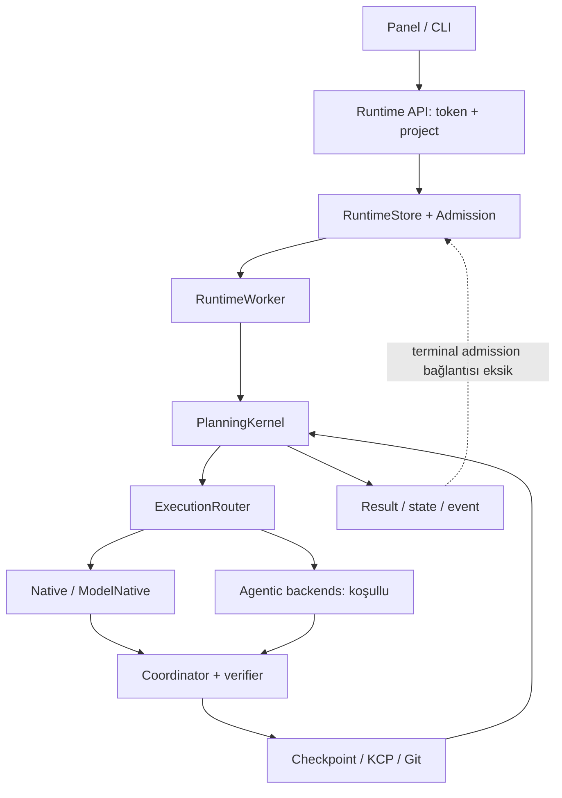

# Gerçek kaynak grafiği ve eksiksiz trace matrisi

**SOURCE_INSPECTED:** bütün bağlantılar `9d3168afb35edf5ad06e6b5e419801493fe04572` içindir; Windows'ta seçilen gerçek route UNKNOWN. `evidence/baseline_inventory.json.gz` her tracked dosyayı; `evidence/import_edges.json` exact statik import kenarlarını ve `evidence/coverage.json` kapsamı içerir. Envanter amaç metni docstring'den türetilmiştir; semantic kanıtı olmayan satırlar UNKNOWN'dır. Dinamik importlar, `extensions.__init__` hyphen package alias'ı ve subprocess CLI kökleri ayrıca hesaba katılır. Import reachability, çağrının çalıştığı anlamına gelmez.

## A — Kullanıcı hedefi

| Kenar / gerçek çağrı | Durum | Denetim sonucu |
|---|---|---|
| `control_panel.submit_goal` → `runtime_panel_bridge.submit_goal_to_runtime` | SOURCE_ONLY | Panel explicit project ve Product confirmation içeriyor |
| `RuntimeHandler.do_POST` → `RuntimeEngine.submit_continue` | SOURCE_ONLY | Token 403; API'de project yoksa config default seçilebilir |
| `submit_continue` → `_normalize_project` → `resolve_project` | SECURITY_UNSAFE (V2 için) | Panel koruması API seviyesinde total değil; registered root + descriptor kontrolleri var |
| `RuntimeStore.create_command` → `CommandAdmissionStore.set_state` | SOURCE_ONLY | Komut ve admission ayrı dosya işlemleri; iki yerde ACTIVE yazımı |
| `_spawn_worker` → `python -m aos.runtime_worker` | SOURCE_ONLY | Detached worker, command/workspace locks; worker PID tek başına yeniden kullanım güvenliği sağlamaz |
| `execute_command` → `run_autonomous_project` | SOURCE_ONLY | Continuous bounded cycles, fingerprint/churn guard var; 1 batch tek başına durma nedeni değil |
| `synthesize_project_situation` → `CanonicalAuthorityResolver.validate_task` | SOURCE_ONLY | Descriptor, SHA ve standing authority mevcut; V2 grant kaynağı burada açık ayrılacak |
| `_reason` → `build_execution_router` → provider | SOURCE_ONLY | Planner structured schema ve adequacy route kullanıyor |
| `compile_execution_plan` → `run_host` → `PersistentCoordinator.execute_next_batch` | SOURCE_ONLY | DAG/type/payload doğrulaması, coordinator checkpoint ve integrity claims var |
| AGENTIC tek dosya+tests → `ModelNativeImplementationBackend` | SOURCE_ONLY | Gerçek edit/test/commit kodu; ortak cost/quota route atlanıyor |
| Native FILE/PROCESS/GIT/CI → receipt/checkpoint | SOURCE_ONLY / HISTORICAL_REPORTED bounded proof | SHA exact edit sağlam; process allowlist OS sandbox değil |
| `detect_completion` → worker terminal | SOURCE_ONLY | Goal acceptance canonical tüm proje status metnine bağlı; farklı semantik |
| Worker terminal → result/state/event | ISOLATED_REAL kusur | Admission kapanmıyor, transaction yok |
| `_recover_one` → `_spawn_worker` | SOURCE_ONLY | ACTIVE ve state/PID kontrolü; eski HOLD/SUPERSEDED otomatik açılmıyor |
| Result → kullanıcı teslimi | UNKNOWN gerçek uçtan uca | B7 gerçek edit raporu var; terminal + interruption + billing bütünleşik kanıt yok |

## B — Resource OS

| Kaynak | Code / gate | Sınıflandırma ve sınır |
|---|---|---|
| Native file/process/git/test | `native_workers.py`, `exact_edit_engine.py` | SOURCE_ONLY; tarihsel bounded WORKS_REAL raporları; exact edit overlap zaten düzeltilmiş |
| Direct free / Nemotron | `ProviderFailoverReasoningBackend`, `provider_registry.py`, `providers/*` | SOURCE_ONLY; bugünkü hesap/auth/quota BLOCKED_EXTERNAL |
| Model+Native | `model_native_backend.py::_call_model` | SECURITY_UNSAFE yeniden kullanım; direct transport/catch-all fallback/billing etiketinden arındırılacak |
| Quota / retry / context / latency | `quota_governor.py`, `provider_observation.py`, `provider_circuit.py`, `resource_orchestrator.py` | SOURCE_ONLY; plan route bağlı, mutation transport aynı kapıdan geçmiyor |
| FreeLLMAPI | `providers/freellmapi_local.py`, `freellmapi_lifecycle.py` | SOURCE_ONLY / BLOCKED_EXTERNAL; code çağrılabilir, gateway hazır olduğu kanıtı yok; loopback ücretsiz upstream garantisi değil |
| Qwen / llama.cpp | `llama_cpp_reasoning_backend.py`, `workers/llama_cpp_lifecycle.py` | SOURCE_ONLY / BLOCKED_EXTERNAL; on-demand headroom, binary/model proof; current RAM UNKNOWN |
| AG managed IDE | `workers/antigravity.py`, adapter discovery/attestation | SOURCE_ONLY; eski exact-session raporu tarihsel; IDE binary ile official agy eşit değil |
| official agy | B11 adapter diff | MOCK_ONLY / SECURITY_UNSAFE; tarihli JSON'da yok; no authority bypass |
| Codex | `codex_cli_backend.py`, `workers/codex_cli_probe.py` | SOURCE_ONLY / BLOCKED_EXTERNAL; LARİ worker session'ı kullanılmayacak |
| Cline | `cline_agentic_backend.py`, `workers/cline_cli_probe.py` | SOURCE_ONLY; profile/attestation var; gerçek entitlement bu ortamda UNKNOWN |
| Aynı provider resume | `agentic_resume.evaluate_agentic_resume` | SOURCE_ONLY; source/workspace/binary/auth uyumluluğu kontrolü var |
| Cross-provider handoff | `ExecutionRouter.execute_with_failover`, `context_pack.py` | MOCK_ONLY kabul kanıtı; gerçek process-death/provider geçişi kanıtlanmadı |
| Paid denial | router enum + registry budgets | SOURCE_ONLY; V1 bazı policy sınıflarında opt-in paid yolu taşıyor; V2 API/config'te paid alanı kabul etmeyecek |

## C — Kalıcılık / güvenlik

| Düzlem | Kaynak ve kanıt | Eksik / karar |
|---|---|---|
| command/state/result/event/admission | runtime_store/admission/worker | ISOLATED_REAL atomicity kusuru; yeni komutlar V2 transaction'a |
| planning/coordinator/run journal | planning_kernel / persistent_coordinator / run_registry | SOURCE_ONLY; task state ile gerçek Git effects birlikte reconcile edilmeli |
| integrity claim / accepted work | integrity_reconciler | SOURCE_ONLY; fikir/semantik fingerprint korunur, ikinci scheduler olarak bağlanmaz |
| KCP hash ledger / index / mirror | knowledge/* | SOURCE_ONLY; hash/seq648 tarihsel; authoritative task state değil; V2 outbox export, mirrors türev |
| resource ledger / quota snapshot | resource_ledger/quota_governor | SOURCE_ONLY; billing proof ve call outcome UNKNOWN ayrı kalır |
| source manifest / slot / nonce | provenance/runtime_assets/runtime_slots/runtime_supervisor | SOURCE_ONLY; 242 byte eşleşmesi tarihli JSON; process health nonce mekanizması değerli |
| Windows Job Object / POSIX process | process_utils | SOURCE_ONLY + tarihsel B8; sahiplik/nonce olmadan PID kill yok |
| symlink / argv / scope | scope_guard/native_workers/model_native | SOURCE_ONLY; resolve containment var ama TOCTOU ve process sandbox sınırlı |
| vault / secret/env/log | secure_store, native redaction | SOURCE_ONLY; ModelNative test process env inheritance ve raw exception redaction ayrıca düzeltilmeli |
| backups | user bundle, 13 tarihi dosya, 79 linked worktree raporu | HISTORICAL_REPORTED; tek disk/offsite restore kanıtı değil; cleanup yok |
| startup/restart | runtime_supervisor/runtime_deploy/local_host | SOURCE_ONLY; opt-in PAUSED_SAFE; live activation ayrı onay |

## D — Operatör kontrolü

Panelde explicit project guard mevcut (4453–4473); admin backend doğrudan API'yi korumaya yetmez. UI'de default/legacy fallback metni ve durum projeksiyonları birden çok kaynak kullanır. `lineage_truth` LEGACY RUNNING'i inferred CURRENT yapabilir; admission ACTIVE ve canlı worker anlamı ayrılmalı. V2 tek komut özeti: state, admission, delivery export, observed worker, selected resource+reason, last verified task, remaining criteria, blocker, artifact path. UNKNOWN görünür kalır.

## E — Teslim / bakım

504 tracked dosya, 6,121,024 byte; 296 Python dosyası AST parse; src/extensions içindeki test olmayan 151 modül 64,807 satır. Dokümandaki candidate snapshot Python dosyaları çalıştırılacak kaynak değildir. 9 pyproject entrypoint'i ve module CLI roots envanterde. `ci.yml` aynı canonical pytest'i offline ve full adımlarında tekrar çalıştırır; güvenlik kapsamında şimdi değiştirilmedi. Yeni core stdlib dışı import gerektirmez. Full V1 install; browser ve SDK'lar gerekince opsiyonel profile ayrılmalı. Windows worktree/gitdir graph, untracked host dosyaları, işleyen startup, dış backup ve account verileri UNKNOWN'dır. Clone'un clean olması Windows'un clean olduğu anlamına gelmez.
