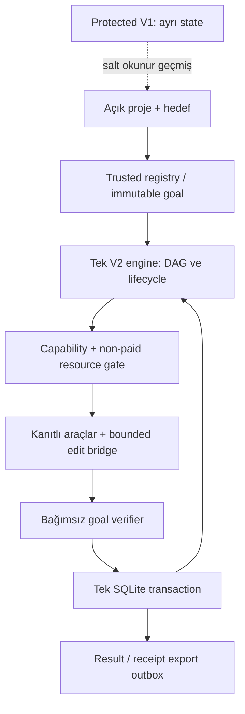

# ADR-AOS-V2-20261018 — HYBRID_V2

**Controller kararı / INFERRED.** Önce independent kaynak audit'i ve bir discriminating storage crash deneyi yapıldı. Sonra seçenek kararı verildi. Aşağıdaki puanlar ölçülmüş başarı oranı veya yüzde olasılık değildir; kaynakta görülen iş kapsamına dayalı 0–5 ordinal mühendislik değerlendirmesidir. Ağırlık toplamı 100.

| Kriter | Ağırlık | A: V1 cerrahi | B: Hybrid | C: yeni core | Gerekçe |
|---|---:|---:|---:|---:|---|
| Gerçek E2E olasılığı | 25 | 2 | 4 | 3 | A: goal/state/transport üç sınırı birlikte onarır; B: tek yeni contract; C: tüm entegrasyonu tekrar kanıtlar. |
| Uygulama yükü (yüksek puan kolay) | 12 | 5 | 3 | 1 | A en az delta; B sınırlı yeni seam; C sıfırdan engine/UX. |
| Operasyon sadeliği | 10 | 2 | 4 | 3 | A çoklu dosya/scheduler yükünü taşır; B tek journal; C sade ama yeni işletim araçları gerekir. |
| Regresyon/veri güvenliği | 15 | 4 | 4 | 2 | A/B korunan V1 dışında; C daha geniş yeniden kullanım ve migration riski. |
| Yetki/güvenlik | 12 | 2 | 4 | 4 | A bayrakların eski anlamlarını taşır; B/C explicit registry + deny. |
| Ücretsiz kaynak kullanımı | 8 | 2 | 4 | 4 | A direct mutation call bypass taşır; B/C unified gateway. |
| Operatör kolaylığı | 6 | 3 | 4 | 4 | B/C bir API/summary; A mevcut karışık durumlar. |
| Kesintiden kurtarma | 8 | 2 | 4 | 4 | B/C transaction + reconcile; A çoklu writer window. |
| Geri dönüş | 4 | 5 | 5 | 3 | A/B V1 coexist; C migration yüzeyi geniş. |

Ağırlıklı değerlendirme A=2.84, **B=3.92**, C=2.95. Seçim yalnız toplamdan çıkmadı: üç bağımsız seam (goal acceptance, transaction lifecycle, governed model edit) zaten değişecek. A'nın 'bir satır fix' olduğu varsayımı kaynakta yanlış. C ise çalışan scope/edit/identity/receipt adapter'larını gereksiz yeniden kanıtlatır.

**Seçilen B:** korunan V1 stable kendi home/port/state'inde erişilebilir kalır. Yeni hedefler explicit `python -m aos.v2` entrypoint'inden ayrı V2 home'a gider. Trusted registry → goal/DAG → non-paid resource gateway → bounded worker bridge → independent verifier → transactional finalize + outbox. Eski dosya ledger'ları aynı yeni görev için ikinci state owner olmaz.

**Tek koruma fallback'i:** mevcut V1 stable + mevcut pause/hold sınırları; yalnız yeniden doğrulanmış mevcut native sınırlı kullanım. V2 durursa otomatik eski Product komutu submit/resume yok. Bu fallback'in kaynak/provenance ve tarihli host korunma kanıtı vardır; bu oturumda Windows canlı operasyon veya tam E2E fallback'i kanıtlanmadı. Tam ürün davranışını kanıtlamayan fallback'e 'tam otonomi kanıtlandı' denmeyecek.

ADR-1: tek authoritative operational journal (`commands/tasks/events/outbox`); SQLite WAL+FULL, local disk only, tek engine ve fenced worker. KCP yönetişim/evidence için korunur. Power-loss veya remote filesystem durabilitesi ölçülmeden iddia edilmez.

ADR-2: grant server-owned config; public body authority/root/backend/paid alanı taşıyamaz. Nonempty explicit scope, exact repo root/base, expiration/revocation, data classification ve allowed argv; `lari`/`lari-ui-v2` bu programda daima deny. Kimlik bilgileri worker ortamından çıkarılır. Güvenlik onayı tek başına health score değildir.

ADR-3: her model çağrısı tek resource gateway. Native ihtiyaç karşılıyorsa çağrı sıfır. Provider id/model/endpoint/credential profile ve gerçek entitlement kanıtı taze ve eşleşmiş olmalı. `PAID`, `UNKNOWN_COST`, overage unknown → deny. Native-only veya uygun alternative yoksa typed wait. Model output token/call/latency bütçesi görev sözleşmesinde; HTTP SDK automatic retry varsayılanları kapatılır, toplam deneme açık sayılır.

ADR-4: her side effect'ten önce immutable task intent; posthash/test/Git trailer verify → accepted. Journal ve Git atomik değildir. Commit olmuş/receipt eksikse önce gerçek commit+postcondition reconcile; commit tekrar yok. Belirsiz dosya değişikliğini geri almak için `reset --hard` yok. İlgisiz stage edilmiş dosyaları commit etme; isolated temporary index, configured hooks disabled only in disposable repository, expected parent/tree ve precise paths.

ADR-5: PROJECT_COMPLETE yalnız o goal'un sabit kriterleri ve independent verifier ile. Bütün projenin ROADMAP/STATE'si COMPLETE olmak zorunda değil. Empty DAG başarı değil. Result/state/admission=CLOSED/run.finished/outbox aynı transaction. UI export pending iken 'teslim edildi' demez; exporter ack ve readback zorunlu.

ADR-6: AG/Qwen/FreeLLMAPI/Codex opsiyonel. Aynı-provider session exact resume ancak source/workspace/binary/auth uyumluysa; başka worker kaynak değiştirdiyse eski konuşmayı körlemesine sürdürme, yeni ContextPack. Resmi agy kurulumu ilk kabulün önkoşulu değil.

**Karar sona erme/pivot tetikleri:** WP2+WP3 sonunda tek happy-path goal hâlâ iki scheduler/state owner gerektiriyorsa; bir focused root-cause repair sonrası aynı atomicity/replay kusuru sürüyorsa; bound grant'ı taşımak için V1 hot edit veya Product yetkisi gerekiyorsa; mandatory paid/cloud bağımlılığı doğuyorsa STOP. C seçeneğinin yalnız execution seam'i değerlendirilir; native exact edit, provider typed errors, source provenance, KCP append ve process ownership kanıtları yeniden kullanılacak. Kaynak/account yokluğu mimari başarısızlık değildir.

19Oct Controller delta: binding AOS-V2-SEAM-1 implementation decisions are in14_IMPLEMENTATION_CONTRACT.md; existing five WPs remain. Published source7afa0e1d4c7768b6a905a2d2987ef2e54b8f0506 includes bounded portable-scope correction with14local tests; raw first4negative failures preserved. Source CI and operational goal proof are distinct. Windows/sandbox/provider/protected51 live evidence remains a gate; no new semantic-audit coverage percentage or E2E claim is made.
