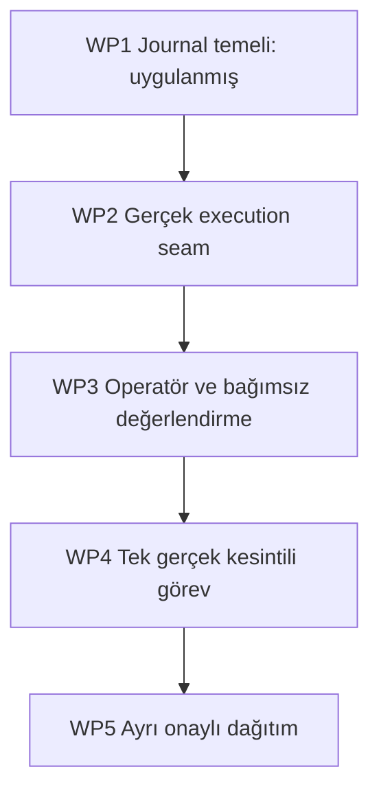

# Sonlu uygulama programı

Bu WPlar yeni B-fazları değildir. Açık eksik → tek iş → tek accepted SHA eşlemesidir. Controller tek integratördür; worker mimariyi yeniden belirlemez. Öngörüler focused engineering saatidir, tamamlanma taahhüdü değil; host/entitlement bekleme süresi dahil değildir.

| WP | Amaç ve zorunluluk | Başlangıç / scope | Owner / verifier | Çıkış / süre |
|---|---|---|---|---|
| WP1 | Atomik command ve task intent: ghost admission ve event duplicate giderme | exact base 9d3168…; `src/aos/v2/{__init__,lifecycle}.py`, `tests/test_aos_v2_lifecycle.py` | Bu AOS oturumu / downstream source reviewer + actual crash tests | 10 local test PASS; engine değil; 3–6h estimate; SOURCE_CANDIDATE |
| WP2 | Trusted registry + API + plan + ortak non-paid gateway + gerçek edit/test/Git/recovery | WP1 accepted carrier; yeni `src/aos/v2/{__main__,engine,api,resources,bridge,acceptance}.py`; mevcut adapter'lar yalnız gerektiği minimal ayrıştırma | AG-AOS default / Controller bağımsız kaynak+negatif test | Auth goal'den worker task'a gerçek bağlantı; fake source fixes yok; 16–28h, belirsizlik yüksek |
| WP3 | Tek operatör girişi, evaluator orchestration, owned process ve exporter | WP2 accepted SHA; `src/aos/v2/operator.py`, `scripts/aos_v2_evaluator.py`, `tests/test_aos_v2_vertical_contract.py`, yalnız V2 test workflow | AG-AOS / evaluator owner + Controller | Ready harness, disabled unless eligible provider; fixture kendi kodunu düzeltmez; 5–9h |
| WP4 | Tek actual ücretsiz provider görevi, gerçek kesinti ve aynı komut recovery | WP3 exact accepted source; yeni disposable kök; sadece onun src dosyaları ve V2 state | Eligible AOS worker / bağımsız evaluator | REAL_E2E_PASS veya RESOURCE_WAIT veya FAIL/REPLAN; 2–4h execution budget; auth bekleme hariç |
| WP5 | Backup/restore, candidate, ayrı host stage/activate/promotion/rollback | WP4 PASS + exact source CI + her live adım için owner izni; native deploy source | AG-AOS / Controller + owner | Sağlığı bağımsız doğrulanmış restore/rollback, opt-in PAUSED_SAFE; 3–6h + owner gates |

WP1/WP2/WP3 toplam ilk uygulama tahmini 24–43h (ilk tasarım tahmini, benchmark değil). Bu oturum WP1 ve evaluator hazırlık araçlarını gerçekten uyguladı. WP2/3/4/5 yürütüldü sayılmaz. Süreyi düşük göstermek için büyük açık görevler gizlenmedi.

Tüm WPlar için: exact entry SHA doğrula; clean isolated branch; bir worktree sahibi; grant no-paid/NO_GO; scope dışı değişiklikte STOP. İlk bağımsız başarısızlık kaydını koru; tek bounded root-cause repair ve retest. Sonraki aynı failure'da mimari gözden geçirme. Kaynak beklerken mock ile real gate kapatma.

Kaynak tahsisi: deterministic inventory/test/Git → native; sıradan plan ve bounded edit → doğrulanmış direct free profile; zor repo-wide implementer işi → gerçekten erişilebilir AG, yoksa **yeni açıkça AOS'a ayrılmış** Codex worker. Mevcut LARİ/Codex session/branch'ine task yollama. Hiçbir agent bu oturumda çağrılmış gibi kaydedilmedi.

Her WP çıkışında receipt: WP_ID, repo/branch, exact entry/head, changed paths, commands+exit codes, CI run ID/head/status veya UNKNOWN, evidence class, source diff, test artifacts+SHA256, protected host untouched observation boundary, authority scope/consumption, one next action. `STATE.extensions.aos_v2.work_packages` tek durum kaynağıdır.

19Oct contract closure:14_IMPLEMENTATION_CONTRACT.md is mandatory for existing WP2/WP3. It resolves actual sandbox enforcement, owner locking, schema2 migration and exact Git effect reconciliation. Add registry.py/sandbox.py and their negative platform tests inside WP2; no new WP IDs. Earlier smaller effort estimate is superseded, not represented as achieved progress.
